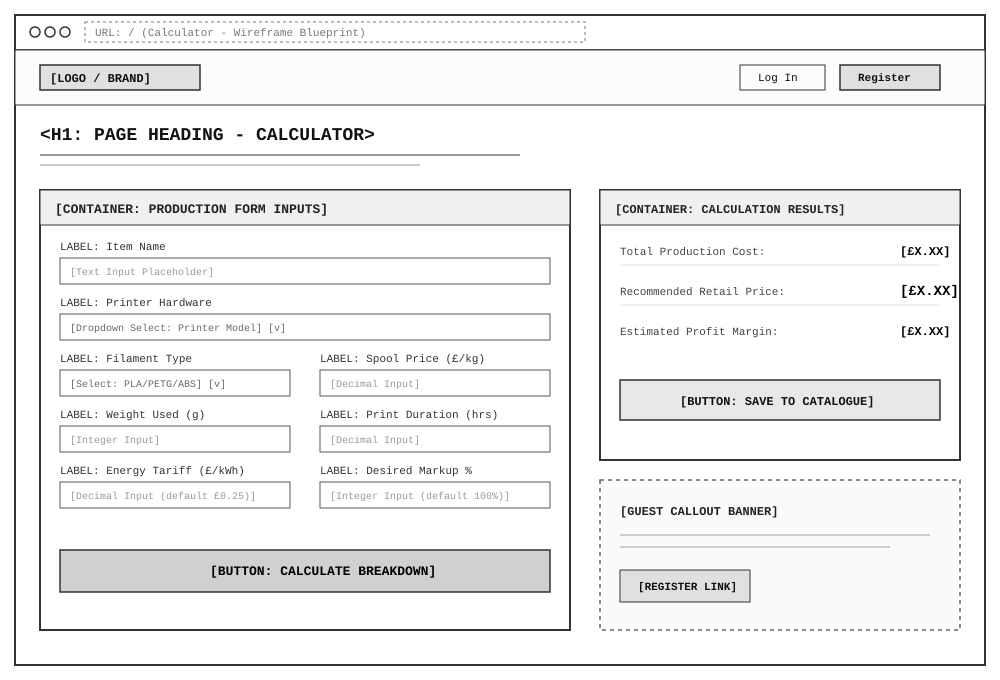
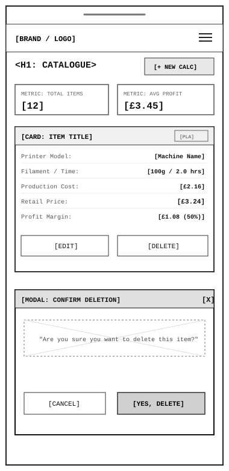

# 🖨️ 3D Print Cost & Retail Price Calculator

🌐 **Live Application:** [https://print-profit-calculator-paul-edbf381bcfdc.herokuapp.com/](https://print-profit-calculator-paul-edbf381bcfdc.herokuapp.com/)

A full-stack Django web application designed for 3D printing hobbyists, makers, and small-batch production businesses. It calculates precise production costs—factoring in filament weight, spool price, machine wattage, electricity tariffs, and material-specific failure buffers—to suggest sustainable retail pricing and project accurate profit margins.

---

## 📋 Table of Contents
1. [Project Overview & UX](#1-project-overview--ux)
2. [Agile Methodology & User Stories](#2-agile-methodology--user-stories)
3. [AI Augmentation & Implementation](#3-ai-augmentation--implementation)
4. [Wireframes](#4-wireframes)
5. [Data Model Architecture](#5-data-model-architecture)
6. [Calculation Logic & Formulas](#6-calculation-logic--formulas)
7. [Features & Defensive Design](#7-features--defensive-design)
8. [Testing & Quality Assurance](#8-testing--quality-assurance)
9. [Bugs & Resolved Issues](#9-bugs--resolved-issues)
10. [Technologies Used](#10-technologies-used)
11. [Local Development & Setup](#11-local-development--setup)
12. [Future Roadmap & Planned Deployment](#12-future-roadmap--planned-deployment)
13. [Credits & Acknowledgements](#13-credits--acknowledgements)

---

## 1. Project Overview & UX

### Target Audience
* **Hobbyist Makers**: Want quick pricing estimates without complex manual spreadsheets.
* **Etsy / Craft Sellers**: Need reliable retail pricing formulas that factor in electricity overhead and print failure risk buffers.
* **Small 3D Print Farms**: Require a persistent catalogue to manage recurring product lines and track profit margins.

### User Goals
* Calculate total print cost (materials + energy + risk buffer) instantly.
* See clear visual separation between production cost and projected profit.
* Save customized print calculations to a private account dashboard.
* Update existing calculations when material costs or energy tariffs fluctuate.

### Design & Typography
* **Color Palette**: Dark charcoal header/navigation (`#212529`), clean off-white background (`#f8f9fa`), primary maker blue (`#0d6efd`), and retail success green (`#198754`).
* **Typography**: Clean system sans-serif hierarchy for cross-device readability.

---

## 2. Agile Methodology & User Stories

Project planning and task tracking were managed using **GitHub Projects** following Agile and MoSCoW prioritization principles.

* **📋 Public Agile Project Board:** [GitHub Projects Kanban Board](https://github.com/users/paulybruv/projects/10/views/1)

### Epics & MoSCoW Prioritization Matrix

| ID | User Story | Epic | MoSCoW Priority | Project Goal Link | Status |
| :--- | :--- | :--- | :---: | :--- | :---: |
| **US01** | As a **Guest Visitor**, I can input item name, printer hardware, filament type, spool price, grams, time, electricity tariff, and profit markup so that I can estimate production costs immediately. | Core Calculator | **Must Have** | Instant Cost Estimation | ✅ Done |
| **US02** | As a **Maker**, I can see a clear breakdown of filament cost, electricity overhead, total cost with failure buffer, recommended retail price, and profit per item. | Core Calculator | **Must Have** | Profit & Retail Transparency | ✅ Done |
| **US03** | As a **User**, I can register, log in, and log out with clear flash notifications so that my personal catalogue remains private and secure. | Authentication & Roles | **Must Have** | Role-Based Access Control | ✅ Done |
| **US04** | As a **Logged-In User**, I can Create, Read, Update, and Delete saved print calculations so that I can maintain an accurate product catalogue over time. | Catalogue CRUD | **Must Have** | Persistent Catalogue Management | ✅ Done |
| **US05** | As a **Logged-In User**, I am prompted with an accessible confirmation modal before deleting a saved print so that I avoid accidental data loss. | Defensive UX | **Should Have** | Defensive Design & Safety | ✅ Done |
| **US06** | As a **Logged-In User**, I can view summary statistical cards (Total Saved Items, Average Profit per Item) at the top of my catalogue. | Analytics Dashboard | **Should Have** | Business Margin Insights | ✅ Done |
| **US07** | As a **Maker**, I can select different filament types (`PLA`, `PETG`, `ABS`, `TPU`) that automatically apply appropriate machine wattages and failure risk buffers (5% vs 15%). | Domain Logic | **Could Have** | Real-World 3D Printing Accuracy | ✅ Done |

---

## 3. AI Augmentation & Implementation (LO8)

**Google Antigravity** (agentic AI coding assistant) and **GitHub Copilot** were strategically leveraged across the software development lifecycle to accelerate scaffolding, full-codebase auditing, debugging, optimization, and testing.

### 8.1 Using AI Tools to Assist in Code Creation
* **Model, Migration & Form Scaffolding**: Used **Google Antigravity** and **GitHub Copilot** to structure the relational `PrinterMachine` and `SavedPrint` models, generate Bootstrap-styled `SavedPrintForm` widgets (including `electricity_rate_kwh`), and author data migration `0002` to automatically seed default 3D printer profiles (`Bambu Lab`, `Prusa`, `Creality`).
* **Auth & Notification Architecture**: Evaluated authentication options with **Antigravity** and transitioned from heavy third-party packages (`django-allauth`) to lightweight standard Django authentication (`django.contrib.auth`) paired with `user_logged_in` / `user_logged_out` signal receivers for real-time flash notifications.

### 8.2 Using AI Tools to Assist in Debugging Code
* **Full-Project Codebase Audit with Antigravity**: Used **Google Antigravity** to perform a comprehensive review of all templates, views, models, and settings—catching a silent Django template bug in `catalogue.html` where `{{ item.retail_price }}` was referenced instead of `{{ item.recommended_retail_price }}`.
* **Floating-Point & Validation Fixes**: Identified binary floating-point rounding discrepancies in currency math and refactored calculations to `decimal.Decimal` (`ROUND_HALF_UP`). Used **Antigravity** to diagnose and resolve live W3C Nu HTML Validator errors (URL-encoding the inline SVG favicon data URI in `base.html` and adding `role="dialog"` to the delete confirmation modal in `catalogue.html`) as well as `fail_silently=True` handling on auth signals during test client execution.

### 8.3 Using AI Tools to Optimize Code for Performance & UX
* **DRY Calculation Refactoring**: Collaborated with **Antigravity** to consolidate duplicate guest (`float`) vs. authenticated (`Decimal`) calculation logic in `views.py` and `models.py` into a single reusable `SavedPrint.calculate_pricing()` method with null-safe printer wattage fallbacks.
* **Accessibility & WCAG Contrast Optimization**: Audited Lighthouse and W3C accessibility reports with **Antigravity**, darkening muted secondary text (`#495057`) to exceed the 4.5:1 WCAG AA contrast threshold, adding skip-to-content navigation, and ensuring clean top-level `<h1>` heading hierarchy.

### 8.4 Using GitHub Copilot & Antigravity to Create Automated Unit Tests
* **Test Suite Generation**: Used **GitHub Copilot** and **Google Antigravity** to scaffold and expand Django `TestCase` classes in `print_calc/tests.py` covering model string representations, `PLA` (5%) and `ABS` (15%) failure buffer calculations, negative input rejection (`MinValueValidator`), view access control redirects, and authenticated CRUD POST workflows.
* **Developer Adjustments to AI Test Output**: Adjusted initial `float` assertions to strict `Decimal("...")` comparisons, added explicit `refresh_from_db()` checks on update tests, and ensured test printer names (`MK4S`) did not collide with seeded migration records.

### 8.5 Reflection on AI's Role and Impact on Workflow
* Pairing **Google Antigravity** (for multi-file architectural reviews, automated terminal test/linter verification, and live W3C validation checks) with **GitHub Copilot** (for inline code and test completions) dramatically improved development velocity and code quality. Every AI suggestion was critically reviewed, tested, and challenged—such as catching unexecuted validation steps early and verifying all 9 unit tests, `flake8`, and W3C checks directly before committing.

---

## 4. Wireframes

Wireframes were constructed to establish visual hierarchy, intuitive form controls, and responsive layouts across viewports:

### Desktop View (Main Calculator & Real-Time Breakdown)


### Mobile View (Responsive Catalogue & Accessible Confirmation Modal)


---

## 5. Data Model Architecture

The application relies on two relational models in `print_calc/models.py`:

    +---------------------------------------+         +---------------------------------------+
    |            PrinterMachine             |         |              SavedPrint               |
    +---------------------------------------+         +---------------------------------------+
    | id (PK)                               |         | id (PK)                               |
    | name: CharField(100, unique)          | <-----+ | user: FK(User, CASCADE)               |
    | brand: CharField(50, blank)           |         | printer: FK(PrinterMachine, SET_NULL) |
    | default_watts: PositiveIntegerField   |         | machine_watts: PositiveInt (nullable) |
    | average_watts_pla: PositiveInt        |         | hourly_depreciation: Decimal(5,2)     |
    | average_watts_abs: PositiveInt        |         | item_name: CharField(150)             |
    | depreciation_per_hour: Decimal(5,2)   |         | filament_type: CharField(20)          |
    | cost_basis_note: CharField(150)       |         | spool_price_per_kg: Decimal(6,2)      |
    +---------------------------------------+         | filament_grams_used: PositiveInt      |
                                                      | purge_grams: Decimal(6,1)             |
                                                      | is_multicolor_run: BooleanField       |
                                                      | spools_json: TextField (JSON)         |
                                                      | plate_quantity: PositiveIntegerField  |
                                                      | flat_setup_cost: Decimal(6,2)         |
                                                      | per_unit_post_cost: Decimal(6,2)      |
                                                      | hardware_json: TextField (JSON)       |
                                                      | apply_min_floor: BooleanField         |
                                                      | min_floor_charge: Decimal(6,2)        |
                                                      | print_time_hours: Decimal(5,2)        |
                                                      | electricity_rate_kwh: Decimal(6,3)    |
                                                      | markup_percentage: PositiveInt        |
                                                      | total_cost: Decimal(8,2)              |
                                                      | recommended_retail_price: Decimal(8,2)|
                                                      | profit_per_item: Decimal(8,2)         |
                                                      | created_on: DateTimeField             |
                                                      +---------------------------------------+

* **23 Distinct Individual Printer Presets (`0003` Migration)**: Seeded into `PrinterMachine` organized by brand (`Bambu Lab`, `Prusa`, `Creality`, `Elegoo`, `Anycubic`, `Resin`, `Custom`), each with its own unique `default_watts`, `depreciation_per_hour`, and purchase cost/lifespan basis note.

---

## 6. Calculation Logic & Formulas

All cost calculations are performed within `SavedPrint.calculate_pricing()` (invoked automatically by `SavedPrint.save()` and `calculator_view`) using Python's `decimal.Decimal` module (`ROUND_HALF_UP`), mirrored live on the client in `static/js/calculator.js`:

1. **Material & Purge Waste Cost:**  
   `Model Filament Cost = (Spool Price / 1000) * Model Grams` (or summed across up to 16 individual AMS spools)  
   `Purge Waste Cost = (Purge Rate / 1000) * Purge Grams`  
   `Material Waste % = (Purge Grams / (Model Grams + Purge Grams)) * 100`

2. **Electricity Cost:**  
   `Electricity Cost = (Machine Watts / 1000) * Print Hours * Cost per kWh`  
   *(Auto-populates `Machine Watts` from the selected printer preset while remaining user-editable; supports regional 3-decimal tariffs such as UK `£0.263/kWh`, US `$0.185/kWh`, and EU `€0.28/kWh`)*.

3. **Machine Wear / Depreciation Cost:**  
   `Depreciation Cost = Print Hours * Hourly Depreciation Rate`  
   *(Auto-populates `Hourly Wear / Depreciation` from the selected printer preset—e.g. `£0.06/hr` for A1 Mini up to `£0.45/hr` for Prusa XL 5-Toolhead—while remaining user-editable)*.

4. **Failure Risk Buffer & Batch Extras:**  
   - Standard materials (`PLA`, `PETG`): **5% buffer** (multiplier: `1.05`)  
   - High-temp / flexible materials (`ABS`, `TPU`): **15% buffer** (multiplier: `1.15`)  
   `Print Production Cost = (Filament Cost + Purge Cost + Electricity Cost + Depreciation Cost) * Failure Multiplier`  
   `Total Plate Cost = Print Production Cost + Flat Setup Labor + (Per-Unit Cleanup Labor * Plate Quantity) + Hardware Add-ons`

5. **Target Selling Price, Minimum Order Floor, Profit & Per-Unit Batch Pricing:**  
   `Target Selling Price = max(Total Plate Cost * (1 + Markup % / 100), Minimum Floor Charge if enabled)`  
   `Profit per Plate = Target Selling Price - Total Plate Cost`  
   `Per-Unit Selling Price = Target Selling Price / Plate Quantity`

---

## 7. Features & Defensive Design

### Implemented Features
* **"Drop & Done" `.gcode` and `.3mf` Slicer Auto-Parser**: Modern drag-and-drop dropzone that inspects OrcaSlicer, Bambu Studio, PrusaSlicer, and Cura `.gcode` / `.3mf` files client-side (via `JSZip`) to auto-populate Printer Model, Print Time, Model Weight, Purge/Waste Weight, and Multi-Color AMS spools.
* **Streamlined Core View + Collapsible Advanced Options**: Keeps the default calculator view uncluttered while providing optional toggles for Batch Plate Quantity, Hands-On Labor (time-based or flat currency), Multi-Color AMS Spool Manager (up to 16 spools), Hardware & Fasteners BOM, and Minimum Order Floor Charge.
* **23 Individual Printer Hardware Presets**: Brand-grouped `<optgroup>` dropdown (`Bambu Lab`, `Prusa`, `Creality`, `Elegoo`, `Anycubic`, `Resin`, `Custom`) that immediately populates editable **Machine Wattage (W)** and **Hourly Wear / Depreciation (£/hr)** fields.
* **Regional Electricity Tariff Pills & Currency Sync**: One-click preset buttons (`UK Ofgem Cap £0.263`, `US National Avg $0.185`, `EU Average €0.28`, `Custom`) that sync currency symbols (`£`, `$`, `€`) across the UI.
* **Industry Markup Presets & Gross Margin Helper**: Quick-select markup buttons (`40%`, `100%`, `200%`, `Custom`) with a live `Markup % = Gross Margin %` educational banner.
* **Role-Based Authentication Suite**: Standard Django authentication with user registration, login/logout flash notifications, and Django Admin hardware management for staff/superusers.
* **"My Catalogue" Saved Prints Workflow**: Responsive cards with live search, filament material filtering, multi-color spool badges with color dots, full cost breakdowns, one-click **Load into Calculator** (`/?load=<id>`), and **Export / Copy Quote** clipboard functionality.
* **Defensive CRUD & Custom Error Pages**: Update and Delete operations restricted exclusively to the creator of the item, backed by custom branded `404.html` and `500.html` error templates.

### Defensive Programming Matrix

| Scenario | Potential Risk | Defensive Mechanism Implemented |
| :--- | :--- | :--- |
| **Unauthenticated URL Access** | Guest attempts typing `/catalogue/` directly | Intercepted by `@login_required`; redirected to `/login/?next=/catalogue/`. |
| **Cross-User Data Tampering** | User B attempts editing/deleting User A's print ID | View queries `get_object_or_404(SavedPrint, pk=pk, user=request.user)`. Returns custom 404 if item does not belong to logged-in user. |
| **Accidental Deletion** | Accidental click on delete button | Accessible Bootstrap modal intercepts action; requires secondary explicit confirmation. |
| **Crawler / GET Deletion** | Web crawler triggers destructive GET request | Delete route only executes deletion on `POST`; GET requests redirect safely back to catalogue. |
| **Invalid / Negative Form Inputs** | Negative or zero values entered for price, weight, time, or kWh rate | Enforced via `PositiveIntegerField` and `MinValueValidator` (`0.01` / `0.001`) with clear inline form error messages. |

---

## 8. Testing & Quality Assurance (LO4)

### 4.1 Automated Python Testing (`python manage.py test`)
Automated unit tests in `print_calc/tests.py` cover models, calculation accuracy, hardware depreciation, batch/AMS/hardware/floor pricing, form validation, view access control, and full CRUD workflows:
* `PrinterMachineModelTests.test_printer_string_representation`: Confirms correct `__str__` formatting.
* `SavedPrintModelTests.test_pla_failure_multiplier_calculation`: Validates `Decimal` precision formulas, 5% PLA failure buffer, and retail pricing.
* `SavedPrintModelTests.test_abs_failure_multiplier_calculation`: Validates high-temp wattage selection and 15% ABS failure buffer.
* `SavedPrintModelTests.test_depreciation_and_custom_watts_calculation`: Validates hourly machine wear/depreciation and custom wattage overrides in `calculate_pricing()`.
* `SavedPrintModelTests.test_batch_multicolor_hardware_and_floor_pricing`: Validates batch plate division, multi-spool AMS costs, purge waste %, hardware BOM, and minimum order floor charge.
* `SavedPrintModelTests.test_negative_form_values_rejected`: Verifies `SavedPrintForm` and `MinValueValidator` reject negative numeric inputs.
* `ViewAccessTests.test_calculator_page_loads_for_anonymous_user`: Verifies public access (HTTP 200).
* `ViewAccessTests.test_catalogue_redirects_unauthenticated_user`: Verifies unauthenticated redirect (HTTP 302).
* `ViewAccessTests.test_catalogue_loads_for_authenticated_user`: Verifies authenticated catalogue access (HTTP 200).
* `ViewAccessTests.test_anonymous_calculator_post_returns_breakdown`: Verifies guest calculation returns itemized filament, electricity, depreciation, buffer, total, retail, and profit breakdown.
* `ViewAccessTests.test_catalogue_filters_by_filament_type`: Verifies `?filament=` query parameter filters catalogue items and summary metrics accurately.
* `CrudOperationTests.test_edit_print_updates_record`: Validates record update via POST request.
* `CrudOperationTests.test_delete_print_removes_record_via_post`: Validates record deletion via POST request.
* `CrudOperationTests.test_load_into_calculator_and_catalogue_summary`: Validates `?load=<id>` pre-population, `get_catalogue_summary()`, spool color dots, quote export text, and accessible dropzone markup.

All 14 automated tests pass with zero errors:
```text
Ran 14 tests in 16.5s
OK
```

### 4.2 JavaScript Test Procedures (`static/js/calculator.js`)
Custom front-end JavaScript in `static/js/calculator.js` powers the 23 printer hardware presets, regional electricity tariff pills, dynamic currency syncing, industry markup presets, and live breakdown card updates:

| JS Feature / Function | User Interaction Tested | Expected Outcome | Result |
| :--- | :--- | :--- | :---: |
| **Printer Hardware Auto-Fill** (`applyPrinterPreset`) | Select any of the 23 printers (e.g. `Bambu Lab X1C`) | Immediately populates `Machine Wattage` (`135W`) and `Hourly Wear` (`£0.17/hr`), updates preset note, and recalculates cost | Pass |
| **Editable Hardware Overrides** (`recalculatePricing`) | Manually tweak populated wattage or hourly depreciation | Retains custom user value without locking the input and recalculates total print cost immediately | Pass |
| **Regional Electricity Presets & Currency Sync** (`syncRatePresetHighlight`, `setCurrencySymbol`) | Click `UK (£0.263)`, `US ($0.185)`, or `EU (€0.28)` | Fills `#id_electricity_rate_kwh`, syncs `.currency-symbol` (`£`, `$`, `€`) across inputs & summary card, and recalculates | Pass |
| **Markup Preset Pills** (`syncPresetHighlight`) | Click `Wholesale (40%)`, `Retail (100%)`, or `Prototyping (200%)` | Updates `#id_markup_percentage`, highlights active pill (`aria-pressed="true"`), and recalculates live margin & price | Pass |
| **Custom Input Detection** (`syncPresetHighlight`, `syncRatePresetHighlight`) | Manually type a custom tariff (`0.07`) or markup (`75`) | Automatically switches the corresponding active preset pill to `Custom` | Pass |
| **Bootstrap Modals & Collapse** (`bootstrap.bundle.min.js`) | Toggle mobile navbar and open/cancel delete modal | Drawer and confirmation modal open, trap focus, and dismiss cleanly | Pass |

### 4.3 Manual Testing Matrix

| Feature | Action | Expected Result | Result |
| :--- | :--- | :--- | :---: |
| **Calculator Form (Guest)** | Fill out inputs and click Calculate Cost Estimate | Itemized breakdown (filament, electricity, wear, buffer, total, selling price, profit) displays with guest callout | Pass |
| **Form Validation** | Submit negative spool price or empty required fields | Submission blocked; inline field error messages displayed | Pass |
| **User Sign Up** | Submit registration form | Account created, user logged in, welcome flash message displayed | Pass |
| **Login / Logout Flash** | Sign in and sign out via navbar | Flash alerts confirm login (`Welcome back...`) and logout (`Safely signed out`) | Pass |
| **Catalogue View & Filter** | Log in, view catalogue, click filament filter pills (`PLA`, `PETG`, etc.) | User-specific prints filter by material and update summary metrics | Pass |
| **Edit Calculation** | Change printer, electricity tariff, or markup preset and submit | New selling price and cost computed, DB updated, success alert shown | Pass |
| **Delete Modal (Cancel)** | Click delete, cancel modal | Modal dismisses, record remains untouched | Pass |
| **Confirm Delete (POST)** | Click delete, confirm in modal | Item removed from DB, catalogue reloads with confirmation message | Pass |
| **Cross-User Access Guard** | Attempt `/edit/<id>/` of another user's print | Returns 404 Not Found error page | Pass |

### Code Validation, WAVE Accessibility & Lighthouse Audits

* **Python PEP 8 (`flake8`)**: Enforced with `.flake8` (`max-line-length = 79`). Passes with **0 errors / 0 warnings** (`100% compliant`).
* **WAVE Web Accessibility Evaluation Tool**: Audited across all pages (`/`, `/catalogue/`, `/edit/<pk>/`, `/login/`, `/signup/`) with **0 Errors, 0 Contrast Errors, 0 Broken ARIA References, and 0 Alerts**.
* **W3C HTML5 & CSS3 Validation** (Tested via official [W3C Nu HTML & CSS Validator](https://validator.w3.org/nu/)):

| Page / File | Validator | Errors | Warnings | Result |
| :--- | :--- | :---: | :---: | :---: |
| `Calculator (/)` | W3C Nu HTML5 | 0 | 0 | **Pass** |
| `Catalogue (/catalogue/)` | W3C Nu HTML5 | 0 | 0 | **Pass** |
| `Edit Print (/edit/<pk>/)` | W3C Nu HTML5 | 0 | 0 | **Pass** |
| `Login (/login/)` | W3C Nu HTML5 | 0 | 0 | **Pass** |
| `Sign Up (/signup/)` | W3C Nu HTML5 | 0 | 0 | **Pass** |
| `static/css/style.css` | W3C CSS3 | 0 | 0 | **Pass** |

* **Google Lighthouse Audits** (Lighthouse 13.4.1, live production build):

| Device Form Factor | Performance | Accessibility | Best Practices | SEO | Agentic Browsing | Core Web Vitals |
| :--- | :---: | :---: | :---: | :---: | :---: | :--- |
| **Desktop** | **99–100** | **100** | **100** | **100** | **100% (1/1)** | FCP: 0.7s · LCP: 0.8s · SI: 0.7s · **TBT: 0 ms** · **CLS: 0** |
| **Mobile** (Throttled 4G) | **98** | **100** | **100** | **100** | **100% (1/1)** | FCP: 1.8s · LCP: 2.2s · SI: 1.8s · **TBT: 0 ms** · **CLS: 0** |

--- | :---: | :---: | :---: | :---: | :---: |
| **Desktop** | **100** | **96** | **100** | **100** | [View Desktop PDF](docs/3dprint-lighthouse-desktop.pdf) |
| **Mobile** | **99** | **95** | **100** | **100** | [View Mobile PDF](docs/3dprint-lighthouse-mobile.pdf) |

---

## 9. Bugs & Resolved Issues

1. **Floating Point Rounding Inaccuracies**:
   * *Issue*: Standard Python `float` operations introduced fractional rounding discrepancies during currency calculations.
   * *Fix*: Re-architected `SavedPrint.calculate_pricing()` to utilize Python's `decimal.Decimal` module with explicit `ROUND_HALF_UP` quantization for both guest and authenticated calculations.
2. **Catalogue Retail Price Template Attribute Mismatch**:
   * *Issue*: `catalogue.html` initially referenced `{{ item.retail_price }}` instead of the model field `{{ item.recommended_retail_price }}`, causing blank retail prices on saved cards.
   * *Fix*: Updated template binding to `{{ item.recommended_retail_price }}`.
3. **Django 5+ `aria-describedby` Broken Reference in Custom Templates (WAVE Audit)**:
   * *Issue*: Django 5.0+ automatically injects `aria-describedby="id_<field>_helptext"` onto form inputs with `help_text`, which WAVE flagged as broken ARIA references when custom `<div class="form-text">` elements lacked matching `id` attributes.
   * *Fix*: Added `id="{{ field.auto_id }}_helptext"` to all help-text containers across `calculator.html`, `edit_print.html`, and `signup.html`.
4. **W3C Nu HTML Validator Errors (Inline SVG Favicon & Modal ARIA Role)**:
   * *Issue*: W3C validation flagged unencoded `<` and `>` characters inside the `data:image/svg+xml` favicon href in `base.html`, as well as `aria-labelledby` on the delete modal `<div>` in `catalogue.html` lacking an explicit `role="dialog"`.
   * *Fix*: URL-encoded the SVG data URI (`%3C`, `%3E`, `%20`) in `base.html`, added `role="dialog"` to the modal container in `catalogue.html`, and flattened `<section>`/`<article>` card wrappers so `<h1>` remains the top-level heading of `<main>`.
5. **Model String Representation Whitespace**:
   * *Issue*: `PrinterMachine.__str__` produced an unexpected leading space when machines were instantiated without an explicit brand.
   * *Fix*: Added conditional string formatting checking for brand existence before prepending.
6. **W3C HTML Accordion `aria-labelledby` Validation Conflict**:
   * *Issue*: A redundant `aria-labelledby` on the generic `#collapseAdvancedOptions` `<div>` was rejected by the W3C validator.
   * *Fix*: Removed it in `calculator.html` (and `edit_print.html`), achieving 100% W3C HTML5 compliance with 0 errors across all routes.
7. **Client-Side Slicer Archive Thumbnail Parsing (`.3mf`)**:
   * *Issue*: Uploaded `.3mf` files showed no build plate preview.
   * *Fix*: Implemented flexible JSZip path traversal (matching `Metadata/plate_1.png` and `top_1.png`) and Base64 conversion to render live 3D build plate previews in the UI banner and pricing card.

---

## 10. Technologies Used

* **Python 3.13 / Django 6.1**: Backend MVT framework, authentication, signals, and ORM.
* **Bootstrap 5.3**: Responsive UI styling, card layouts, and accessible modal overlays.
* **HTML5 / CSS3**: Semantic markup and custom stylesheet (`static/css/style.css`).
* **SQLite / PostgreSQL (`dj-database-url` & `psycopg2-binary`)**: Local development database and production cloud relational database support.
* **Gunicorn & WhiteNoise**: Production WSGI HTTP server and static file serving.
* **Flake8**: Strict PEP 8 linting enforcement.

---

## 11. Local Development & Cloud Deployment (LO6)

### Local Development Setup

1. **Clone the repository:**
   ```bash
   git clone https://github.com/paulybruv/3d-print-profit-calculator.git
   cd 3d-print-profit-calculator
   ```

2. **Create and activate a virtual environment:**
   ```bash
   python -m venv .venv
   source .venv/Scripts/activate  # Windows Git Bash (or .\.venv\Scripts\Activate.ps1 in PowerShell)
   ```

3. **Install dependencies:**
   ```bash
   pip install -r requirements.txt
   ```

4. **Configure local environment variables (`env.py`):**
   Create an `env.py` file in the root directory (excluded from Git via `.gitignore`):
   ```python
   import os

   os.environ["SECRET_KEY"] = "your-local-secret-key"
   os.environ["DEBUG"] = "True"
   ```

5. **Apply database migrations (automatically seeds default 3D printers):**
   ```bash
   python manage.py migrate
   ```

6. **Execute automated unit tests & linter:**
   ```bash
   python manage.py test
   flake8
   ```

7. **Start the local development server:**
   ```bash
   python manage.py runserver
   ```
   Open `http://127.0.0.1:8000/` in your browser.

### Cloud Deployment Procedure (Heroku)

The project is pre-configured for Heroku deployment with `Procfile`, `gunicorn`, `whitenoise`, `dj-database-url`, `psycopg2-binary`, and environment-driven `DEBUG=False` security:

1. **Create Heroku Application**:
   * Log in to the Heroku Dashboard and click **New → Create new app**.
   * Enter a unique app name and select your region.
2. **Configure Environment Variables (Config Vars)**:
   * Navigate to the **Settings** tab and click **Reveal Config Vars**.
   * Add the following keys:
     * `SECRET_KEY`: A strong, randomly generated production secret key.
     * `DATABASE_URL`: Your production PostgreSQL connection URI (e.g., from Code Institute Postgres / Neon / ElephantSQL).
     * *(Ensure `DEBUG` is omitted or set to `False` in production).*
3. **Connect GitHub Repository & Deploy**:
   * Open the **Deploy** tab and select **GitHub** as the deployment method.
   * Connect the `paulybruv/3d-print-profit-calculator` repository.
   * Scroll to **Manual deploy**, select the `main` branch, and click **Deploy Branch** (Heroku automatically runs `collectstatic` via WhiteNoise and starts `web: gunicorn config.wsgi` from `Procfile`).
4. **Run Production Database Migrations**:
   * Click **More → Run console** in the top-right of the Heroku dashboard and execute:
     ```bash
     python manage.py migrate
     ```
   * Migration `0002` automatically seeds the default `PrinterMachine` hardware profiles (`Bambu Lab P1S / X1C`, `Bambu Lab A1 / A1 Mini`, `Prusa MK4`, `Creality Ender 3 V3 SE`) so the calculator works immediately.
   * Optionally create an admin superuser via `python manage.py createsuperuser` to manage printers at `/admin/`.

---

## 12. Future Roadmap

- [ ] **Filament Spool Inventory & Stock Tracking**: Automatically track remaining spool weights as projects are saved.
- [ ] **PDF & CSV Client Quote Exporter**: Generate clean, branded printable quote summaries for customer commissions.
- [ ] **OctoPrint & Klipper (Moonraker) Webhook Integration**: Fetch actual print completion runtimes and real bed/hotend energy telemetry over the local network.
- [ ] **Dedicated Resin (SLA/DLP) Mode**: Cost modeling for photopolymer resin volume, wash/cure station electricity, and IPA bath degradation.
- [ ] **Marketplace Fee Calculator Toggle**: Quick-toggle deductions for Etsy/Shopify transaction fees to calculate true take-home margins.

---

## 13. Credits & Acknowledgements

* **Django Documentation**: For standard authentication, signal receivers, and `Decimal` model validation patterns.
* **Bootstrap Team**: For modern CSS component architecture and responsive grid system.
* **Code Institute**: For assessment rubric guidelines and full-stack development best practices.